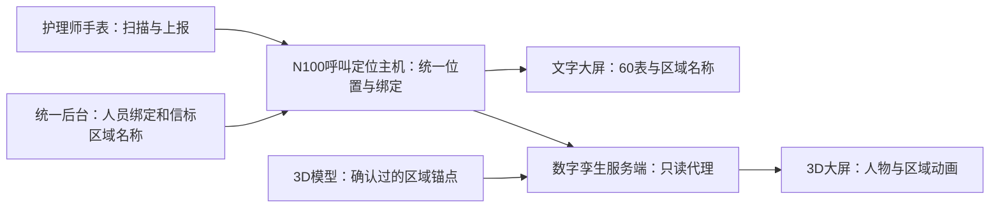

# 护士站文字大屏与3D数字孪生双屏设计

日期：2026-11-20（America/Los_Angeles）。按用户确认：一块显示目前呼叫/60表内容，另一块显示伴月轩3D场景；护理师位置以文字和3D人物分别展示，数据互通。

本轮在development/bycall完成设计、共用快照和渲染器无关适配器；未修改数字孪生项目源码、未部署N100、未启用真实3D连接。现场仍按上一已发布版本记录处理，不能将本地测试当双屏已经接通。

## 1. 总体原则：一份事实，两种展示

主机是呼叫、绑定、信标区域及位置新鲜度的唯一业务判定端。两块屏都是消费者，不互相复制定位结果、不各算RSSI、不直接交换管理员密钥，也不各建员工绑定表。



例如同一份数据是“员工A / 手表w-01 / 区域24-1 / SPA馆南侧 / fresh”：文字屏显示姓名及“SPA馆南侧”，3D屏把员工A的人物标记放在24-1对应的模型锚点。员工A换成备用表后仍是同一个人物，不按手表SN另建一个人物。

两屏也可由两台显示主机驱动，只要连接同一个权威N100服务；不要求屏幕之间直接连线。若同一N100连接双显示器，文字页与3D页使用独立窗口/进程，不让3D渲染卡住呼叫主服务。

## 2. 两个显示端的职责

| 项目 | 文字主机大屏 | 3D场景大屏 |
| --- | --- | --- |
| 主要内容 | 现有呼叫、语音留言、60表信息、在线/体征/区域文字 | 建筑/楼层/区域场景、护理师人物和位置状态 |
| 位置事实 | 主机共用定位快照 | 同一个主机快照经只读代理传递 |
| 人物身份 | staff员工编号关联姓名、当前watch设备 | 同一个staff关联人物模型；姓名/岗位从授权统一主数据关联，不另建人工员工台账 |
| 区域名称 | 使用主机area字段 | 使用同一个area标签，不在3D页面维护另一套名称 |
| 业务写操作 | 沿用原后台授权流程 | 第一阶段只读，不直接接单/换表/改定位 |
| 告警 | 保留主机屏的呼叫提醒 | 可显示状态，默认不再复制同一套呼叫铃声，避免重复提醒 |

本轮明确互通的是定位、人员与当前设备关系、在线状态及数据有效性。呼叫详情、姓名目录、体征等若后续需要出现在3D，应按显示目的扩展授权投影；不把整个管理员快照直接暴露给3D浏览器。

## 3. 共用接口与一致性

- 文字页：`GET /station/snapshot`中的`location_state`。
- 3D服务端：`GET /integration/twin/locations`的完整响应。
- 两者调用同一个`HostService.location_snapshot()`，再由同一份内部状态生成卡片与只读区域投影；不是两套互不相关的位置查询。
- 3D沿用独立`BYCALL_TWIN_KEY`，仅在数字孪生服务端使用。浏览器调用自己同源的后端代理，不包含主机管理员密钥或只读密钥。未配置时503是“未启用”，不是正常空场景。

共用数据增加以下字段（兼容添加，schema仍为bycall.location.v1）：

| 字段 | 用途 |
| --- | --- |
| source_epoch | 当前主机进程的会话标识，重启后改变 |
| sequence | 本会话内事实状态序号；有新报告/绑定/状态变化/过期时递增 |
| revision | 事实内容摘要；可诊断两个显示端是否在看同一份状态 |
| delivery=full | 全量快照，新结果替换旧集合，消失的人物必须移除 |
| server_time | 本次响应的主机时间，用来建立显示端时间基准 |
| consumer_timeout_seconds=8 | 展示端超过8秒未取得可接受新快照即标记数据连接中断 |
| items[].staff / watch | 员工稳定身份与当前设备，换表只改关联 |
| items[].zone_id / room / area / floor | 统一区域标识、房间、名称与楼层 |
| items[].location_status / location_reason | 同一个fresh/unknown/stale判定及原因 |
| items[].valid_until | 当前有效观测的绝对失效时间；未知/过期则null |
| items[].offline_since / device_last_seen | 同源设备断开起点与最后心跳，用于一致的状态解释 |

只改变显示年龄age_seconds不创建新revision；新的位置报告即使仍在同一区域，也会更新有效期并产生新版本。未知/过期状态没有当前zone_id，不把last_known当实时坐标。

**同一source_epoch + sequence的人员关系、区域、状态和有效期应一致。** 两个屏轮询时间可以相差一个刷新周期；这是可观测延迟，不承诺毫秒级锁步。丢失顺序或新主机会话出现时，消费者丢弃旧批次，不允许迟到数据把人物倒退。

## 4. 刷新与失效规则

建议文字屏保持现有2秒业务轮询；3D后端集中每2秒拉取一次主机并向浏览器提供同源数据，避免每个人物独立请求。第一阶段用全量快照，60人量级无需先引入新的消息中间件；后期可在同一个契约下改用SSE/WebSocket，不能另造定位判定。

手表默认10秒上报，位置更新的实际时延还包括扫描周期、区域平滑、网络与显示刷新。2秒刷屏不等于2秒定位，也不提供厘米级精度。默认位置有效期仍为30秒（随真实上报间隔调整），心率每分钟与体征有效期是另一组规则。

- fresh且有有效场景映射：文字显示区域名称；3D显示人物区域标记。
- unknown：文字显示位置未知/扫描异常等；3D停止位置动画并移除当前空间标记，状态列表可保留该人员。
- stale/设备离线：文字明确过期/离线；3D不得继续把旧点标成实时位置。历史若需查看，要在独立历史模式中明确标注时间。
- 数据连接中断：两屏8秒未取得新快照后标记“状态未知/连接中断”，不能把主机连接中断误写成所有手表离线；不继续显示实时空间点或体征值。
- 未取得第一份快照：显示等待连接，不能把空集合解释为“没有护理师在岗”。
- 恢复连接/主机重启：接受新全量快照，重建当前集合；旧会话迟到帧被拒绝。

文字屏已使用同源valid_until，并增加断流状态隐藏，避免一块屏显示“实时”而另一块已经判过期。

## 5. 场景映射和动画

唯一身份关系：员工staff → 当前手表watch → 主机区域zone_id → 3D场景锚点。映射键为store_id+zone_id；floor保持真实配置，不把演示16层改写为高新店24F。

区域映射由两部分组成：主机统一维护区域名称及实际房间/楼层；3D项目维护该区域对应的scene_id、anchor_id和模型坐标。允许多颗同区域信标映射同一个锚点。模型坐标只用于画图，不回写成手表实测坐标；坐标单位、楼层高度和模型原点须在实际模型中标定。

示例为虚构映射，禁止直接当作现场坐标：

```js
const anchors = new Map([
  ['example-store:24-1', {
    scene_id: 'example-scene', anchor_id: 'example-spa-south',
    floor: 'example-floor', position: [10, 0, 5]
  }]
]);
```

第一阶段人物采用站立/状态动画，区域改变可淡出淡入或切换锚点；适配器输出crossfade而不是“测得行走路线”。只有以后取得更细观测、确认的可通行路径与时序，再设计行走动画，并清楚区分视觉插值与真实采样轨迹。

映射缺失、楼层不匹配、锚点不合法时，3D显示“场景位置未配置”并隐藏空间标记，绝不放在模型原点或猜一个最近房间。此时主机的真实区域事实仍可为fresh，3D配置错误不能反过来更改主机定位。

## 6. 已提供的3D适配器

`integration/twin-location-state.mjs`是无网络、无密钥、不依赖具体3D引擎的ES模块，可在网页/Three.js或数字孪生服务端使用；其他引擎按同一契约移植。

```js
import { TwinLocationState } from './twin-location-state.mjs';
const feed = new TwinLocationState();

// 由现有3D后端代理取得主机响应；这里不写主机地址或密钥。
feed.accept(snapshot);
const sceneState = feed.project(anchors);
// 3D引擎按people[].staff复用模型，按pose设置模型锚点，按effect控制出现/淡出。
// pose=null时必须停止并隐藏位置标记；完整快照中不再存在的staff必须移除。
```

调用project不仅在收到新帧后进行，也应约每秒检查一次超时；绘制帧率和定位拉取频率分开。accept拒绝乱序、退休主机会话重放、重复人员、冲突版本和门店串数据；没有改变全量快照权限，没有向3D工程写代码或真实配置。

## 7. 双屏部署与运维

支持同一N100双输出或两台局域网显示终端。文字屏打开/station，3D屏打开实际数字孪生服务地址（尚未提供，不猜测地址）。两个窗口设置不同显示角色和屏幕编号；同浏览器、同源时必须分开本地配置键，不能复用文字页的设置/回执ID。3D浏览器运行心跳应在3D后端登记，不能为了登记显示器把管理员密钥发给3D前端。

需要区分“3D后端能拉到数据”和“第二块屏真的在运行场景”；仅有代理请求成功不证明显示器开机或WebGL场景正常。显示角色注册与实际画面健康上报属于接入真实3D项目后的工作，本轮未把它们冒称已实现。

N100上3D应与MQTT/呼叫引擎隔离进程，场景出错不阻塞主机告警。实际场景模型、纹理、人物动画和双输出性能尚未测量；必要时单独显示机仍连接同一主机。是否满足60人物和目标帧率，需要用真实场景实测，不能凭接口测试保证。

## 8. 实施顺序与验收

1. 主机侧：共用位置快照、版本/失效规则及两接口一致性（本轮已实现）。
2. 3D接入：按本契约接入服务端代理与适配器，确认真实模型/页面地址、统一员工ID、区域锚点与只读凭据（待对方工程实施）。
3. 单表验收：同区域/跨区域/换表/空观测/断网/重启，两屏同一版本显示同一事实，过期后都不保留实时旧点。
4. 双屏验收：60表与实际3D场景同时运行，检查主机呼叫响应、显示延迟、GPU/CPU/内存与熄屏恢复；确认一屏退出不影响另一屏和呼叫。
5. 通过后再按既定流程备份、发布、配置现场；本轮没有再次上线或改信标实物。

本轮验证结果见VALIDATION.md及根目录当前开发任务。接口/适配器软件验证不能代替真实两屏与3D场景联调。
