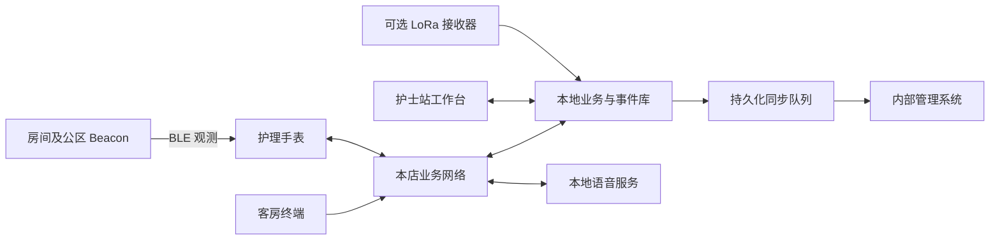

# 两店现场网络与四层部署草案

日期：2026-10-26。此文是基于平面图的勘测草案，不是施工图，未测量无线信号，未确定 AP、Beacon 或机柜实际位置。

最近修订：2026-10-27。枣园 23 层采用用户本次更新图，旧版“以功能区为主”的布局判断作废。

## 网络判断

两店均为大楼网络承包商维护的联通外网，房间有 AP、公区有 Wi-Fi。接入运营商与 AP 数量不能说明二层/三层内网关系。需要承包商确认：是否同网段、是否有访客/客户端隔离、不同 SSID 是否互通、跨层路由、DHCP/DNS/NTP 是否依赖外网、是否网页认证、AP 控制器断外网能否运行以及设备漫游能力。

建议在现有网络允许时建立独立业务 SSID/VLAN 和受控路由，让客房终端、手表、本地业务与语音服务可达，客户上网与呼叫业务按权限隔离。无需把所有设备放在同一广播域；经过明确放行的路由也可以工作。若承包商不能提供稳定内网，评估自管交换机/AP/跨层链路，先询价和确认布线权限，再改动现场。

每店拟独立部署本地运行节点，承载业务、数据库、事件日志和本地语音服务。高新 16 与 24 层必须核实跨层有线网络，不能靠隔八层无线穿透。枣园 23/24 层同样先查有线连接。若跨层长期无法可靠互通，再评估每层独立节点与汇总，不能用同一呼叫的两个无协调写入节点造成重复接单。

管理系统部署位置未确定；它与本地节点的同步链路另行设计。云端不得成为基础呼叫和本店通话的必经环节。业务网络只对需要的端点开放，不设置公网 SIP 或设备管理入口。

## 逐层图纸解读与勘测区

| 门店楼层 | 图纸观察 | 初步调查重点 |
|---|---|---|
| 高新16 | 识别 1610/1611/1612、1617—1624 共 11 个客房标签；长直走廊，图示护理站、托管与康养区域 | 护理站至走廊两端漫游；1617/1618 门内外信标串扰；水电井/电梯附近遮挡 |
| 高新24 | 长走廊两侧客房，右侧图示接待、护理站、瑜伽、厨房、托管与后勤空间；房间标注重复使用设计文字，缺乏可直接采纳的完整经营房号 | 两端覆盖、公共区跨 AP 通话；现场补经营房号，不能从设计房名生成设备编号 |
| 枣园23 | 更新图：上侧 2301、2302，下侧 2303、2305、2306、2308、2309，转折处另一侧 2307，共 8 个房号；另有厨房、多功能室、更衣标记、会客接待区、产康室和电梯。长条未标注区域用途不据图推定 | 房内 AP 与走廊漫游；2301/2302 及 2308/2309 相邻房 BLE 串扰；2307 与转折附近覆盖；确认使用边界、公共呼叫点、护士站位置和 24 层内网连接 |
| 枣园24 | 折线走廊。图示 666、888，金033/032/031/030/029/028/026/024/023/022/021/020，漫011/010/009/008/006/005/003/002/001，共 23 个房间样标签；另有洗头、保洁、卫生间、托管和游泳馆 | 走廊转折、电梯核心筒与两端覆盖；核对 666/888 用途，结合 23 层 8 个房号核对全店经营客房总数；护士站位置待核实 |

高新 34 间与图纸经营房号未逐一对应。枣园更新后为 23 层 8 个房号加 24 层 23 个房间样标签，合计 31 个标签，与原纪要 30 间经营客房尚差 1 个标签。标签不等同经营客房，不能直接上调总房量或认定哪个房间不经营；须核对实际用途与最新台账。23 层没有 2304 标注，不补造缺失房号或把功能间当客房。

布点以逻辑区域建账，逐个记录房间、走廊段、护理站、托管、产康、楼梯与电梯邻近区。Beacon 优先在试点两房、门口/走廊与护理站测试功率和安装位置；不直接按每 5—8 米机械布满。图纸缺少 AP 台账、墙体材料和可信定位坐标，本阶段不给安装坐标或全店采购数量。

## 发给网络承包商的调查模板

请按高新16、高新24、枣园23、枣园24逐层提供以下资料。无需提供管理员密码或客户信息。

| 项目 | 需要记录/证明 |
|---|---|
| 设备与拓扑 | AP、交换机、路由、控制器型号及管理方；机柜位置；PoE 和空闲网口 |
| SSID 与认证 | 房间/公区 SSID、是否同业务网、网页认证、掉线后是否人工重登 |
| 隔离与路由 | 客户端隔离、访客网络、VLAN/子网、ACL，终端到本地主机可达性 |
| 跨层连接 | 光纤/网线/路由路径、链路管理权、断外网时是否仍可通信 |
| 本地基础服务 | DHCP 续租、本地 DNS/地址发现、时钟来源、控制器离线行为 |
| 语音与安全 | 本地信令和媒体双向通行，端口按最终产品清单审批，排查 SIP ALG 影响 |
| 无线 | 信号/干扰/丢包/时延、频段、信道、漫游、门关闭和夜班真实条件 |
| 供电与维护 | AP/交换机/主机供电回路，UPS 候选，重启与固件维护窗口 |

## 四种故障分开验收

| 故障 | 预期与测试 |
|---|---|
| 仅外网断开 | 本店呼叫、接单、语音、到场与留痕继续；管理系统同步排队，恢复后去重补传；实际断开 WAN 后验证 |
| 跨层链路断开 | 记录受影响区域与护士站可见告警；未证明分层自治前不能承诺跨层继续 |
| 局部 AP/无线故障 | 受影响手表/房间显式离线或降级；LoRa 若有只能证明事件到网关，不能证明手表和语音仍可用 |
| 断电/本地主机故障 | UPS 覆盖范围、故障提示、恢复时间、数据恢复和人工联络均须演练；看门狗不能替代兜底 |

服务主机重启时，先前已持久化任务应恢复，设备重发不得重复建单；故障期间新事件是否可在终端缓存必须由样机确认。可靠性验证前保留现有联络方式。
